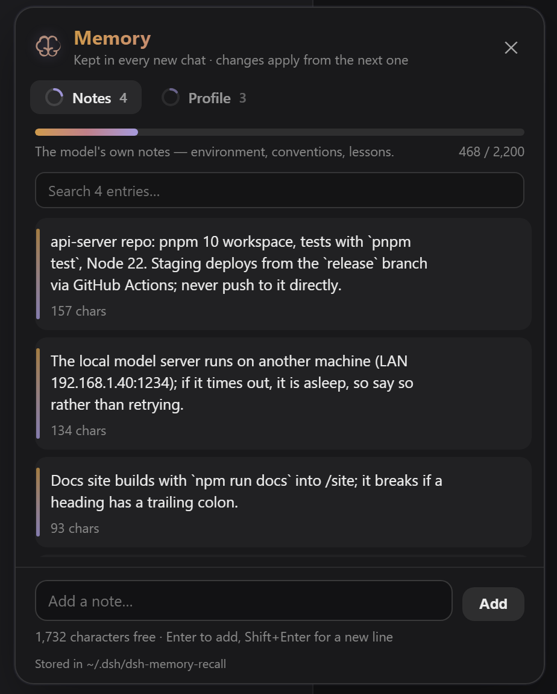
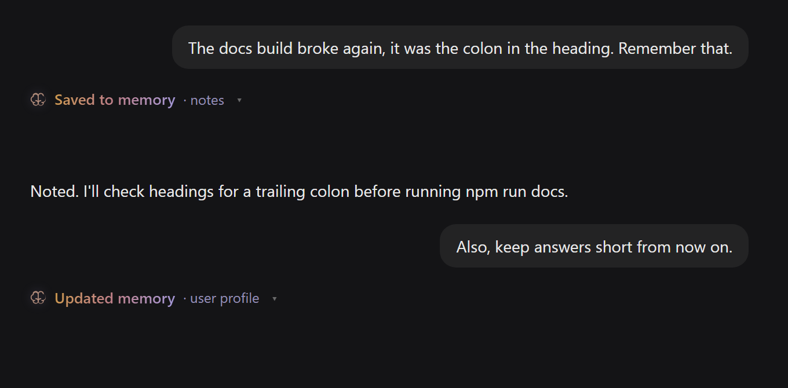
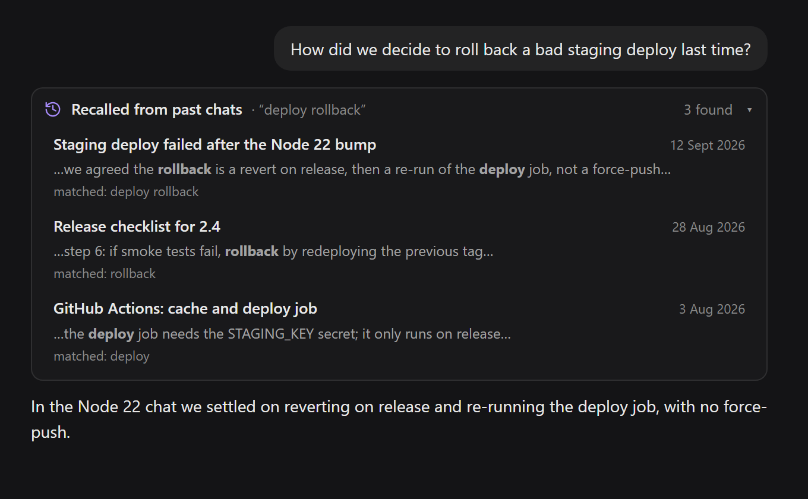
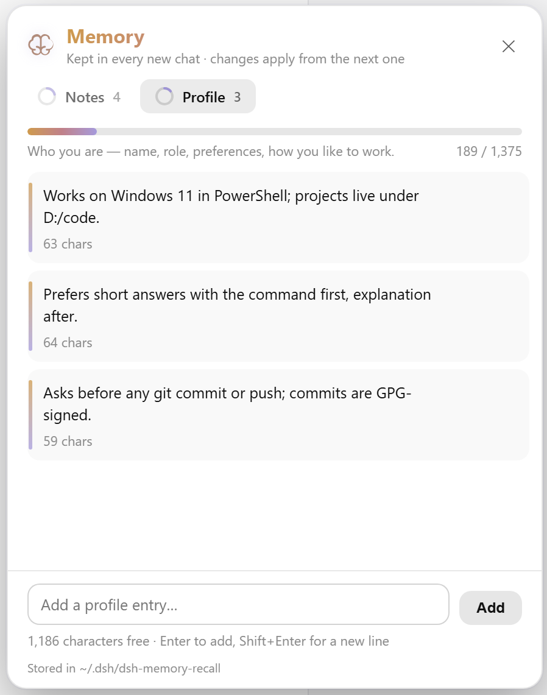

# dsh-memory-recall

English | [中文](README.zh.md)

      

A [DeepSeek Harness](https://github.com/deepseek-ai/deepseek-harness) plugin that gives the model a memory, in the style of [Hermes Agent](https://github.com/NousResearch/hermes-agent): what it learns about you and your projects carries into every new chat, and it can look back through your earlier chats — **only after you allow it**.

**Everything stays on your machine.** Two small text files, dsh's own session index, no embeddings, no service, no telemetry.



It does six things:

- **A `memory` tool** — the model keeps two short files: a **user profile** (who you are, how you like to work) and its **own notes** (environment facts, conventions, lessons). Every chat gets both, as a context message you can see in the chat — at the start, again after a change or a compaction.
- **A 🧠 button in the message box** — lit when this chat has memory, dim when it has none, amber when the memory changed since; click it to see what this chat is running on.
- **A `session_search` tool** — the model reads your earlier chats to answer *"what did we decide last time?"*. dsh's own approval prompt asks you first, saying what it wants to look for.
- **A 🧠 Saved to memory note in the chat** — every save shows what changed and how full memory is, so nothing is remembered behind your back.
- **A sidebar 🧠 Memory panel** — everything kept, in two tabs, with edit, delete, add and search.
- **Chats and workspaces in the `@` menu** — grouped by workspace, under their real titles, so you can hand the model a chat or point its search at one workspace.

## Install

Requires a working dsh (0.1.5 or later) with a `web` profile.

```sh
dsh plugin --profile web add dsh-memory-recall
dsh --profile web
```

Or install from GitHub or a local folder instead:

```sh
dsh plugin --profile web add github:adithyanraj03/dsh-memory-recall
dsh plugin --profile web add /path/to/dsh-memory-recall
```

Then **restart dsh** (`dsh --profile web`) if it was already running, and **hard-refresh the browser** (Ctrl+Shift+R / Cmd+Shift+R) — a plain refresh can serve a cached client bundle. **🧠 Memory** appears at the bottom of the sidebar.

### Turn on dsh's full-text search (recommended)

`session_search` uses dsh's own session index, which dsh ships **switched off**. Add this to your profile's `cordis.patch.yml` (`~/.dsh/profiles/web/cordis.patch.yml`):

```yaml
- id: session-query-sqlite
  config:
    path: '/absolute/path/to/.dsh/session-search.db'
    openAt: first-search
```

`first-search` opens the index only when something first searches; a file path keeps it across restarts. The index is derived from your session logs, so deleting the file only costs a rebuild. An override replaces the row's whole config — keep both keys.

Without it, `session_search` still works: it falls back to a literal scan of your 150 most recent chats — slower and unranked — and says so in its card.

## What you get

### Memory that carries over

Just talk. The model saves what will matter later — that you use PowerShell, that a server lives on another machine, that the docs build breaks on a trailing colon — and each save appears in the chat. Click it to see exactly what changed and how full that store is:




You can also ask directly: *"remember that I prefer short answers"*, *"forget that I use npm"*.

Memory reaches the model as a context message — logged in the chat as 🧠 **Memory loaded** — before its first answer, and again after anything changes or the conversation is compacted, so a save made mid-chat is used in that same chat from the next step. The system prompt keeps only the short how-to, which never changes, so dsh's prompt cache holds.

### Looking back through earlier chats

Refer to an earlier conversation — *"what did we decide about the rollback?"*, *"do it like last time"* — and the model calls `session_search`. dsh's approval prompt takes over the message box with what it wants to read, e.g. *Search your earlier chats for "deploy rollback".*, with **Allow** and **Deny**. The chats it found appear in a card, each with its date, the matching lines and a link to open it:



It returns the chats' actual messages — nothing summarised, nothing invented — cut to about 9,000 characters so one search cannot flood the context. The asking chat and sub-agent sessions are never results.

### The Memory panel

**🧠 Memory**, at the bottom of the sidebar above ⏱️ Scheduled when both are installed, opens everything that is kept:

- **Notes** and **Profile** tabs, each with a ring and a bar showing how full it is.
- **Edit** or **delete** any entry in place (hover it), with an inline confirm for delete.
- **Add** an entry yourself, and **search** once a tab holds a few.
- **⚙ Display settings** — turn the 🧠 button in the message box and the chats and workspaces in `@` on or off, per browser.
- With the sidebar collapsed, it becomes a single icon, like Settings.



Edits you make here are your own words, so they are not scanned (see [Safety](#safety)), but they still respect the budget. Hand edits to the files show in the panel at once and in open chats from their next step.

### Chats and workspaces in the @ menu

Type `@` in the message box. Below dsh's own files and folders, your chats are listed **grouped by workspace**, under the titles your sidebar shows:

- **Just `@`** — *This workspace* with its most recent chats, then *Workspaces* with every other one and how many chats it holds, then chats in no workspace.
- **`@` + text** — matching workspaces, then matching chats under their workspace's heading.
- **Tab, or the chevron, on a workspace** — all of its chats, with an *All workspaces* crumb back.

**Pick a chat** and dsh attaches a read-only snapshot of it to your message, exactly as its own `@` chat rows do — no search and no permission prompt, because you chose it. **Pick a workspace** and it reaches the model as `[workspace "Web Search" — /path/to/Web Search]`; `session_search` then searches only that workspace's chats (after asking, as always).

Every chat gets a readable name — its title, or the start of its first message if it never got one. Sub-agent sessions are left out, and nothing is capped at 50. These rows replace dsh's own flat `@` chat list while its file rows stay as they are; dsh offers no switch for that, so the plugin wraps its `@` source and restores it when unloaded.

## How asking works

- **Reading earlier chats asks first**, through dsh's own approval prompt.
- **One Allow covers that reply.** A search is usually followed by a closer read of the best hit; asking twice for one question is noise. The permission ends when the reply finishes, so the next question asks again.
- **Deny means nothing is read**, and the model is told not to ask again in that reply. If the prompt is withdrawn (you stopped the reply) or nobody can be asked, nothing is read either.
- **Saving to memory does not ask** — it is always shown in the chat and can be undone in the Memory panel. This matches Hermes Agent's default.

If dsh runs in `danger-full-access` mode its approval policy is `never`, which **rejects** every approval request without prompting — so recall is refused there. Set `askBeforeRecall: false` if you want recall without asking in that mode.

## What the model gets

Two parts, so dsh's prompt cache holds:

1. **The how-to** — a short, unchanging system-prompt note on how memory works. It is the only memory in the prompt prefix, so it never invalidates the cache.
2. **The memory itself** — a context message, logged in the chat as 🧠 **Memory loaded**, with the two stores rendered as Hermes renders them:

```
══════════════════════════════════════════════
USER PROFILE (who the user is) [14% — 189/1,375 chars]
══════════════════════════════════════════════
Works on Windows 11 in PowerShell; projects live under D:/code.
§
Prefers short answers with the command first, explanation after.
```

The budgets are small on purpose — **2,200 characters of notes and 1,375 of profile**, Hermes's defaults, together roughly 900 tokens — because they are paid in every chat. When a store is full, a save that would overflow it is refused whole, never cut; the model is shown the entries and consolidates in one batch that merges or drops stale entries and adds the new one, checked against the final size. Raise the budgets with `limits` (below) if you would rather pay more per chat.

Sub-agent sessions do not get the message; they are the model's own workers.

## Configuration

All optional, on this plugin's row in the profile's `cordis.patch.yml`:

```yaml
- id: dsh-memory-recall
  config:
    limits:
      memory: 4000
      user: 1375
```

| Key | Default | Meaning |
|---|---|---|
| `dir` | `~/.dsh/dsh-memory-recall` | Where `USER.md` and `MEMORY.md` live |
| `limits` | `{memory: 2200, user: 1375}` | Character budgets for the notes and the profile |
| `recall` | `true` | `false` drops `session_search` and keeps memory |
| `askBeforeRecall` | `true` | `false` reads earlier chats without asking |

An override replaces the row's whole config, so restate every key you set. Restart dsh after changing it.

## Safety

Memory is re-read into every future chat, so a poisoned entry would keep instructing the model until someone deleted it. Every write **the model** makes is scanned for prompt-injection and exfiltration phrasing — *ignore previous instructions*, *don't tell the user*, piping secrets to a URL, SSH keys, edits to dsh's own config, hidden Unicode — and refused with the reason. The patterns are Hermes Agent's.

Other guards:

- A change re-reads the file first, so a hand edit is never overwritten by a stale copy; writes are atomic and one at a time.
- Replace and remove need a piece of text unique to one entry; an ambiguous one is refused, not guessed.
- A batch is all-or-nothing.

## How it works

- **Host side** (`src/index.js`, `src/inject.js`): registers the `memory` and `session_search` tools, keeps a short how-to in each new top-level chat's system prompt on `agent/session-start`, and before every model step (`agent/pre-step`) appends the current memory to the step's messages as a logged context message when the chat does not already see it — at the start, after a change, and after a compaction. It serves the panel's routes under `/plugin-data/dsh-memory-recall/`. Recall goes through dsh's `sessionQuery` service and its `approval` service; nothing talks to the network.
- **Client side** (`lib/client.js`, plain JavaScript, no build step): the in-chat chip and recall card replace dsh's own rows for those two tools through the `tool.call.toolview` slot; the 🧠 **Memory loaded / reloaded / updated** row is a `conversation.chat.node` that shadows the plugin's own context message at priority −10 and delegates every other row; the 🧠 button mounts into `conversation.input.right`; the panel mounts into `sidebar.footer.action`; the `@` rows are an `inputTriggers` source.
- **Files**:

  ```
  ~/.dsh/dsh-memory-recall/USER.md     the user profile
  ~/.dsh/dsh-memory-recall/MEMORY.md   the model's notes
  ```

  Plain text, entries separated by a line holding only `§` — the same format as Hermes, readable and editable by hand.

## Requirements

- dsh 0.1.5 or later, with a `web` profile — from 0.2.1 also dsh 0.1.7+ and 0.2.x
- Node 22+
- No runtime dependencies — the client bundle requires only `react`

## Credits

The design — two bounded stores, a frozen per-chat snapshot, the batch-against-final-budget rule, `session_search`'s shapes, the §-delimited files and the threat patterns — comes from [Hermes Agent](https://github.com/NousResearch/hermes-agent) by Nous Research (MIT). The brain icons are Lucide's (ISC) and Phosphor's (MIT).

## Licence

MIT — see the [LICENSE](LICENSE) file, which also carries the notices for Hermes Agent, Lucide and Phosphor.
