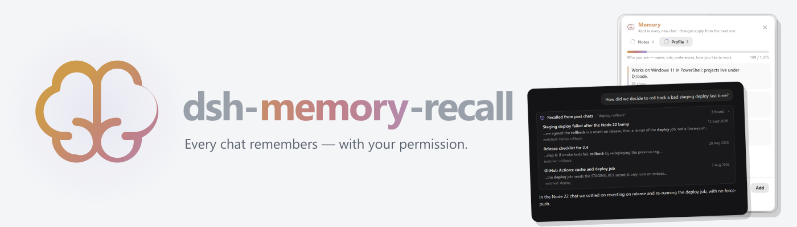

<picture>
  <source media="(prefers-color-scheme: dark)" srcset="assets/banner-dark.png">
  
</picture>

<br>

# dsh-memory-recall

[English](README.md) | 中文

      

一个 [DeepSeek Harness](https://github.com/deepseek-ai/deepseek-harness) 插件，以 [Hermes Agent](https://github.com/NousResearch/hermes-agent) 的风格为模型提供记忆：它学到的关于你和你的项目的信息会带入每一个新会话；它还能回看你的早期会话——但**只在你允许之后**。

**一切都留在你的机器上。** 两个小文本文件、dsh 自己的会话索引，没有嵌入模型，没有服务，没有遥测。


它做六件事：

- **`memory` 工具** — 模型维护两个短文件：**用户档案**（你是谁、你喜欢怎样工作）和**它自己的笔记**（环境事实、约定、教训）。每个会话都会以一条聊天中可见的上下文消息收到这两份内容——在会话开始时，以及在记忆变更或对话压缩之后再次送达。
- **消息框里的 🧠 按钮** — 本会话有记忆时点亮，没有时变暗，记忆自上次查看后发生变化时呈琥珀色；点击即可查看本会话正运行在什么记忆之上。
- **`session_search` 工具** — 模型通过读取你的早期会话来回答"上次我们决定了什么？"。dsh 自己的审批提示会先征求你的同意，并说明它想查找什么。
- **聊天中的 🧠「已保存到记忆」提示** — 每次保存都显示改了什么、记忆还剩多少，绝不当着你的面偷偷记。
- **侧边栏 🧠 Memory 面板** — 所有已保存的内容，分两个标签页，支持编辑、删除、添加和搜索。
- **`@` 菜单中的会话与工作区** — 按工作区分组、显示真实标题，你可以把一个会话交给模型，或把它的搜索指向某个工作区。

## 安装

需要一个可用的 dsh（0.1.5 或更高版本）并带有 `web` 配置档。

```sh
dsh plugin --profile web add dsh-memory-recall
dsh --profile web
```

也可以从 GitHub 或本地文件夹安装：

```sh
dsh plugin --profile web add github:adithyanraj03/dsh-memory-recall
dsh plugin --profile web add /path/to/dsh-memory-recall
```

然后，如果 dsh 已在运行，请**重启 dsh**（`dsh --profile web`），并**强制刷新浏览器**（Ctrl+Shift+R / Cmd+Shift+R）——普通刷新可能仍使用缓存的客户端包。侧边栏底部会出现 **🧠 Memory**。

### 开启 dsh 的全文搜索（推荐）

`session_search` 使用 dsh 自己的会话索引，而 dsh 出厂时**默认关闭**它。把下面这段加到你的配置档的 `cordis.patch.yml`（`~/.dsh/profiles/web/cordis.patch.yml`）：

```yaml
- id: session-query-sqlite
  config:
    path: '/absolute/path/to/.dsh/session-search.db'
    openAt: first-search
```

`first-search` 表示只有当第一次有内容被搜索时才建立索引；指定文件路径可让它跨重启保留。索引由你的会话日志派生——删掉那个文件只损失一次重建。覆盖会替换该条目的整个 config，所以两个键都要保留。

不开启也没关系：`session_search` 仍会工作——退回到对你最近 150 个会话做字面扫描——更慢、没有排序——并在卡片里说明这一点。

## 你会得到什么

### 带得走的记忆

正常聊天即可。模型会保存以后用得上的信息——你用的是 PowerShell、某台服务器在另一台机器上、文档构建会被一个尾随冒号弄坏——每次保存都会出现在聊天里。点开即可看到确切改了什么、那个存储还剩多少空间：


你也可以直接说："记住我偏好简短回答"、"忘掉我用 npm 这件事"。

记忆以一条上下文消息送达模型——在聊天中记录为 🧠 **Memory loaded**——先于它的第一次回答；任何变更或对话压缩之后会再次送达，因此会话中途保存的记忆从下一步起就在同一会话中生效。系统提示词里只保留一段简短且永不变化的用法说明，所以 dsh 的提示缓存始终有效。

### 回看早期会话

提到早前的对话——"上次回滚我们是怎么定的？"、"照上次的做法来"——模型就会调用 `session_search`。dsh 的审批提示会接管消息框，写明它想读什么，例如 *Search your earlier chats for "deploy rollback".*，并给出 **Allow** 和 **Deny**。找到的会话以卡片呈现，每个都带日期、命中的行和一个可打开的链接：


它返回会话的真实消息——不摘要、不编造——并截到约 9,000 字符，一次搜索冲不垮上下文。发起询问的会话和子代理会话永远不会出现在结果里。

### Memory 面板

侧边栏底部的 **🧠 Memory**（两者都安装时位于 ⏱️ Scheduled 上方）打开所有已保存的内容：

- **笔记** 和 **用户档案** 两个标签页，各有一个圆环和一条进度条显示已用多少。
- 就地**编辑**或**删除**任何条目（悬停显示），删除有内联确认。
- 自己**添加**条目；标签页条目多了可以**搜索**。
- **⚙ 显示设置** — 按浏览器分别开关消息框里的 🧠 按钮和 `@` 中的会话与工作区。
- 侧边栏收起时，它缩成一个图标，和 Settings 一样。


你在这里做的编辑是你自己的话，因此不会被扫描（见[安全](#安全)），但仍受预算约束。手工编辑文件会立即反映到面板中，并在打开的会话的下一步生效。

### @ 菜单中的会话与工作区

在消息框输入 `@`。在 dsh 自己的文件和文件夹之下，你的会话**按工作区分组**列出，使用侧边栏显示的标题：

- **只输 `@`** — 先是 *This workspace* 及其最近的会话，然后是 *Workspaces* 列出其他所有工作区及各自会话数，最后是不属于任何工作区的会话。
- **`@` + 文字** — 先匹配工作区，再在各工作区标题下匹配会话。
- **在工作区上按 Tab 或点展开箭头** — 列出它的全部会话，并有 *All workspaces* 面包屑返回。

**选中一个会话**，dsh 会把它的只读快照附到你的消息上，和它自己的 `@` 会话行完全一样——不搜索、不弹审批，因为是你选的。**选中一个工作区**，模型收到的是 `[workspace "Web Search" — /path/to/Web Search]`；`session_search` 随后只搜索该工作区的会话（照例先征求同意）。

每个会话都有一个可读的名字——它的标题，若从未有过标题则是第一条消息的开头。子代理会话被排除，且不做 50 条截断。这些行取代 dsh 自带的扁平 `@` 会话列表，而它的文件行保持不变；dsh 没有提供开关，所以插件包装了它的 `@` 来源，卸载时再还原。

## 询问是如何工作的

- **读取早期会话会先征求同意**，通过 dsh 自己的审批提示。
- **一次 Allow 覆盖那次回复。** 搜索之后通常紧跟对最佳命中的一次细读；一个问题问两遍是噪音。回复结束时权限即终止，下一个问题会重新询问。
- **Deny 意味着什么都不读**，并且模型会被告知在那次回复里不要再问。如果提示被撤回（你中止了回复）或无人可问，同样什么都不读。
- **保存到记忆不需要询问**——它总是显示在聊天里，并可在 Memory 面板撤销。这与 Hermes Agent 的默认行为一致。

如果 dsh 运行在 `danger-full-access` 模式，其审批策略是 `never`，它会**拒绝**一切审批请求而不弹提示——因此回看功能在该模式下会被拒绝。若你想在该模式下不询问直接回看，请设置 `askBeforeRecall: false`。

## 模型得到什么

两部分，以保证 dsh 的提示缓存有效：

1. **用法说明** — 一段简短、永不变化的系统提示词说明，讲清记忆如何工作。它是提示前缀里唯一的记忆内容，因此永远不会使缓存失效。
2. **记忆本身** — 一条上下文消息，在聊天中记录为 🧠 **Memory loaded**，其中两个存储按 Hermes 的样式渲染：

```
══════════════════════════════════════════════
USER PROFILE (who the user is) [14% — 189/1,375 chars]
══════════════════════════════════════════════
Works on Windows 11 in PowerShell; projects live under D:/code.
§
Prefers short answers with the command first, explanation after.
```

预算故意很小——**笔记 2,200 字符、用户档案 1,375 字符**（Hermes 的默认值），合计约 900 token——因为它们每个会话都要付费。当某个存储满了，会溢出的保存会被整体拒绝、绝不截断；模型会看到现有条目并做一次合并——合并或丢弃过时条目并加入新条目——按最终大小校验。愿意每个会话多付一点，就用 `limits`（见下）调高预算。

子代理会话不会收到这条消息；它们是模型自己的工人。

## 配置

全部可选，写在配置档 `cordis.patch.yml` 中本插件的条目上：

```yaml
- id: dsh-memory-recall
  config:
    limits:
      memory: 4000
      user: 1375
```

| 键 | 默认值 | 含义 |
|---|---|---|
| `dir` | `~/.dsh/dsh-memory-recall` | `USER.md` 和 `MEMORY.md` 的位置 |
| `limits` | `{memory: 2200, user: 1375}` | 笔记与用户档案的字符预算 |
| `recall` | `true` | `false` 去掉 `session_search`，保留记忆 |
| `askBeforeRecall` | `true` | `false` 读取早期会话不再询问 |

覆盖会替换该条目的整个 config，所以请把你设置过的每个键都重新写出。修改后重启 dsh。

## 安全

记忆会被重新读进每一个未来的会话，因此一条被投毒的条目会不断给模型下指令，直到有人删掉它。**模型**做的每一次写入都会被扫描提示注入和渗出措辞——*ignore previous instructions*、*don't tell the user*、把密钥管道到 URL、SSH 密钥、编辑 dsh 自己的配置、隐藏 Unicode——并附原因拒绝。这些模式来自 Hermes Agent。

其他防护：

- 变更会先重新读取文件，所以手工编辑永远不会被过期副本覆盖；写入是原子的且串行。
- Replace 和 remove 需要对某一条目唯一的文本；有歧义就拒绝，而不是猜。
- 批量操作要么全成、要么全不成。

## 工作原理

- **宿主侧**（`src/index.js`、`src/inject.js`）：注册 `memory` 和 `session_search` 工具，在 `agent/session-start` 为每个新的顶层会话的系统提示词保留一段简短用法说明，并在每个模型步骤之前（`agent/pre-step`）当会话还看不到当前记忆时，把它作为一条有记录的上下文消息追加到该步骤的消息里——在开始时、变更后、以及压缩后。面板的路由挂在 `/plugin-data/dsh-memory-recall/` 下。回看走 dsh 的 `sessionQuery` 服务和 `approval` 服务；没有任何东西访问网络。
- **客户端**（`lib/client.js`，纯 JavaScript，无构建步骤）：聊天内的 chip 和回看卡片通过 `tool.call.toolview` 插槽取代 dsh 对这两个工具自带的行；🧠 **Memory loaded / reloaded / updated** 行是一个 `conversation.chat.node`，以 −10 优先级遮蔽插件自己的上下文消息并把它行委托出去；🧠 按钮挂载到 `conversation.input.right`；面板挂载到 `sidebar.footer.action`；`@` 行是一个 `inputTriggers` 来源。
- **文件**：

  ```
  ~/.dsh/dsh-memory-recall/USER.md     用户档案
  ~/.dsh/dsh-memory-recall/MEMORY.md   模型的笔记
  ```

  纯文本，条目之间用只含 `§` 的一行分隔——与 Hermes 相同的格式，可手读可手改。

## 要求

- dsh 0.1.5 或更高版本，带 `web` 配置档——自 0.2.1 起同样支持 dsh 0.1.7+ 和 0.2.x
- 0.2.3 — 记忆消息在 dsh 0.2.x 上使用 v4 的 source kind
- Node 22+
- 无运行时依赖——客户端包只依赖 `react`

## 致谢

设计——两个有界存储、按会话冻结的快照、按最终预算校验的批量规则、`session_search` 的形态、§ 分隔的文件以及威胁模式——来自 Nous Research 的 [Hermes Agent](https://github.com/NousResearch/hermes-agent)（MIT）。大脑图标来自 Lucide（ISC）和 Phosphor（MIT）。

## 许可证

MIT — 见 [LICENSE](LICENSE) 文件，其中同时包含 Hermes Agent、Lucide 和 Phosphor 的声明。
