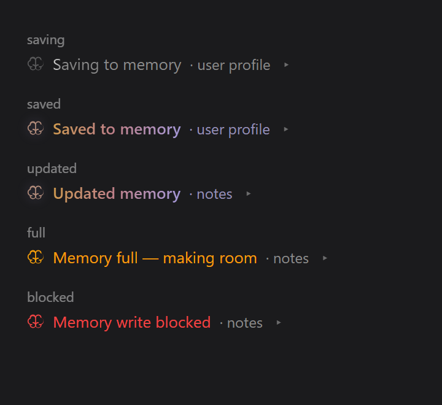
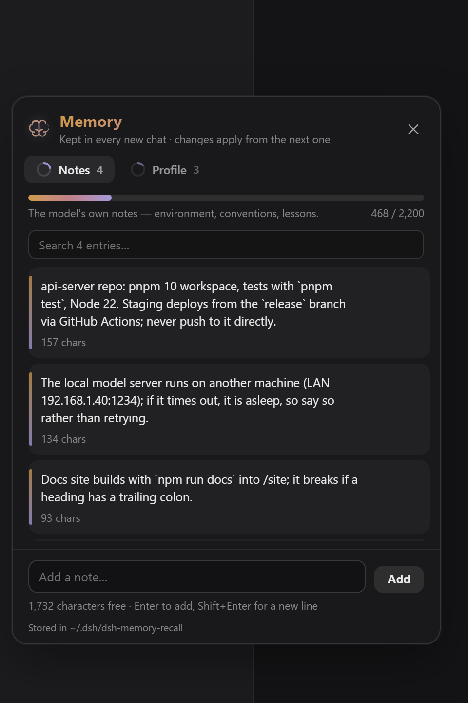
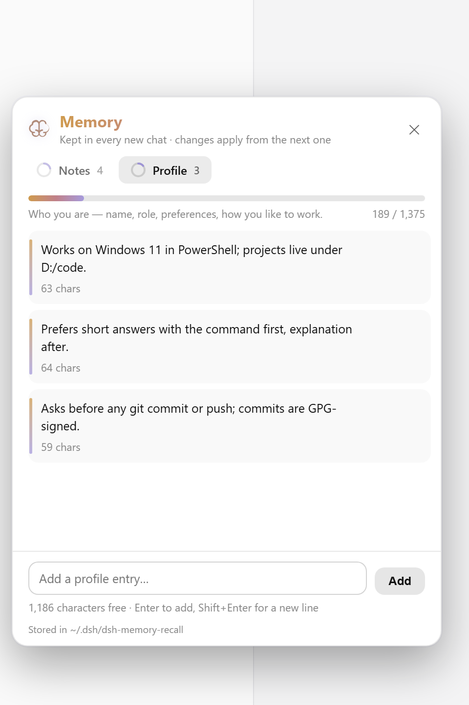

# dsh-memory-recall

A [DeepSeek Harness](https://github.com/deepseek-ai/deepseek-harness) plugin that gives the model a memory, in the style of [Hermes Agent](https://github.com/NousResearch/hermes-agent): what it learns about you and your projects carries into every new chat, and it can look back through your earlier chats — **only after you allow it**.

**Everything stays on your machine.** Two small text files, dsh's own session index, no embeddings, no service, no telemetry.

[View on GitHub](https://github.com/adithyanraj03/dsh-memory-recall){: .btn }

      

---

## Install

```sh
dsh plugin --profile web add dsh-memory-recall
dsh --profile web
```

Or install from GitHub or a local folder instead:

```sh
dsh plugin --profile web add github:adithyanraj03/dsh-memory-recall
dsh plugin --profile web add /path/to/dsh-memory-recall
```

Then restart dsh if it was already running and hard-refresh the browser (Ctrl+Shift+R / Cmd+Shift+R) — a plain refresh can serve a cached client bundle. **🧠 Memory** appears at the bottom of the sidebar.

### In the desktop app

The desktop dsh installs from its own **Plugins** settings: click **Add plugin**, paste `dsh-memory-recall` (or the GitHub address), and click **Install**. The dialog confirms with the **Installed** state. Installed plugins do not update automatically yet — to upgrade, uninstall and install again.

### Turn on dsh's full-text search (recommended)

`session_search` uses dsh's own session index, which dsh ships **switched off**. Add this to your profile's `cordis.patch.yml` (`~/.dsh/profiles/web/cordis.patch.yml`):

```yaml
- id: session-query-sqlite
  config:
    path: '/absolute/path/to/.dsh/session-search.db'
    openAt: first-search
```

`first-search` opens the index only when something first searches; a file path keeps it across restarts. Without it, `session_search` still works — a literal scan of your 150 most recent chats, slower and unranked, and it says so in its card.

---

## What it does

### A memory the model keeps

The model maintains two short files: a **user profile** (who you are, how you like to work) and its **own notes** (environment facts, conventions, lessons). Every chat gets both as a context message logged in the chat as 🧠 **Memory loaded** — at the start, and again after a change or a compaction.

Just talk. The model saves what will matter later, and each save appears in the chat with its own budget:


The five states a save can end in — saving, saved, updated, full, and refused by the scan:



The 🧠 button in the message box is lit when this chat has memory, dim when it has none, amber when the memory changed since — click it to see what this chat is running on.

### A Memory panel



Everything kept, in two tabs — **Notes** and **Profile** — each with a ring and a bar showing how much of the budget is used. Edit or delete any entry in place (hover shows the actions), add your own, and search once a tab holds a few. **⚙ Display settings** toggle the 🧠 button and the `@` rows per browser — and carry the **budget sliders**: drag the notes and profile character budgets (≈ tokens shown), saved with the memory files and applied from the chat's next delivery; reset returns to the `limits` in `cordis.patch.yml`. With the sidebar collapsed it becomes a single icon, like Settings.



### Looking back, with permission

Ask *"what did we decide last time?"* and the model calls `session_search`. dsh's own approval prompt takes over the composer first, saying what it wants to read, with **Allow** and **Deny**. The card it returns holds the chats' actual messages — nothing summarised, nothing invented — each with a date, the matching line and a link to open it:


- **One Allow covers that reply.** The search is usually followed by one close read of the best hit; asking twice per question would be noise. The permission ends when the reply ends, and the next question asks again.
- **Deny means nothing is read**, and the model is told not to re-ask in that reply.
- **Saves never ask** — they always show in the chat and can be undone from the panel.

### Chats and workspaces in the `@` menu

Type `@` in the message box. Under dsh's own files and folders, your chats are grouped **by workspace**, under their real titles. Picking a chat attaches its read-only snapshot to the message — no search, no prompt, because you chose it. Picking a workspace sends `[workspace "Name" — /path]`, and `session_search` then searches only that workspace's chats, still asking first.

---

## Tools

| tool | what it does |
|---|---|
| `memory` | the two stores — read, add, replace, remove, batch — with the budget checked on the final result |
| `session_search` | earlier chats behind dsh's approval prompt: best match, a chat's messages, or a listing |

Subagent chats get neither — the context message and the tools go to top-level chats only.

---

## Configuration

On the plugin's row in your profile's `cordis.patch.yml` — all optional:

```yaml
- id: dsh-memory-recall
  config:
    dir: '/path/to/store'     # where USER.md and MEMORY.md live (default ~/.dsh/dsh-memory-recall)
    limits:                   # character budgets (Hermes's defaults); the panel's sliders override them once moved, until reset
      memory: 2200
      user: 1375
    recall: false             # drop session_search, keep memory
    askBeforeRecall: false    # read earlier chats without asking
```

An override replaces the row's whole config, so re-write every key you set. Restart dsh after a change.

---

## Privacy

No telemetry, no network. Memory is plain text in `~/.dsh/dsh-memory-recall/` (`USER.md`, `MEMORY.md`, and `settings.json` once a slider moves), entries separated by a `§` line — Hermes's format, readable and editable by hand. Writes the model makes are scanned with Hermes Agent's threat patterns and refused with the reason; manual edits and panel edits are never scanned.

---

## Requirements

- dsh 0.1.5 or later, with a `web` profile — from plugin 0.2.1 also dsh 0.1.7+ and 0.2.x
- Node 22+
- No runtime dependencies — the client bundle requires only `react`

The design — two bounded stores, a frozen per-chat snapshot, batch-against-final-budget, `session_search`'s shapes and the threat patterns — comes from [Hermes Agent](https://github.com/NousResearch/hermes-agent) by Nous Research (MIT). The brain icons are Lucide's (ISC) and Phosphor's (MIT).

Licensed MIT. Issues and pull requests at [github.com/adithyanraj03/dsh-memory-recall](https://github.com/adithyanraj03/dsh-memory-recall).
